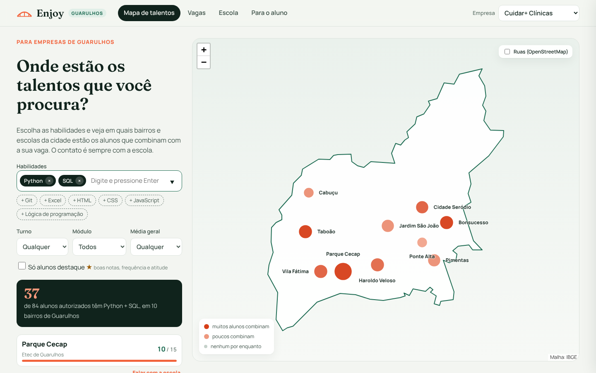
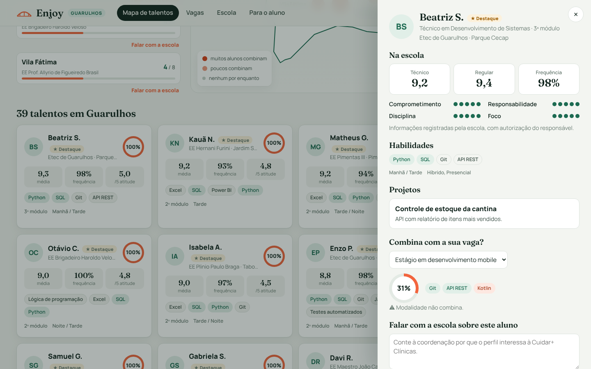
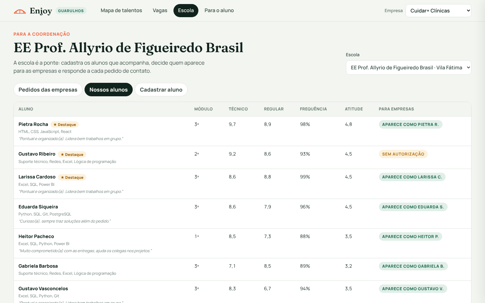

# Enjoy · Guarulhos

**Onde estão os talentos das escolas de Guarulhos?** O Enjoy mostra no mapa da cidade em quais bairros e escolas estão os alunos de curso técnico que combinam com uma vaga. A empresa conversa com a **escola**, que conhece o dia a dia de cada aluno e decide quem indicar.



## O problema

- **A empresa de Guarulhos** precisa de estagiários e jovens aprendizes, mas não sabe em qual escola da cidade estão os alunos com as habilidades que procura.
- **O aluno** muitas vezes não sabe que existe essa oportunidade, nem que o esforço dele no dia a dia é o que abre a porta.
- **A escola** acompanha os alunos de perto e é quem melhor sabe quem está pronto. Por isso ela fica no centro, e não um cadastro feito pelo próprio aluno.

## Como funciona

| Quem | O que faz no sistema |
|---|---|
| **Escola (coordenação)** | Cadastra os alunos que acompanha: habilidades, médias no técnico e no ensino regular, frequência e uma avaliação de **comprometimento, responsabilidade e disciplina**. Marca quem tem autorização do responsável para aparecer às empresas e responde a cada pedido de contato. |
| **Empresa** | Escolhe as habilidades e vê no mapa de Guarulhos onde estão os alunos que combinam. Filtra por bairro, turno, média e "destaque". Vê o perfil e **fala com a escola**, sobre um aluno específico ou pedindo indicações para uma vaga. |
| **Aluno** | Não se cadastra: o perfil dele já está na escola. A página "Para o aluno" mostra o que a escola observa, como uma oportunidade chega até ele e quais vagas existem agora na cidade. |



## Regras de negócio

- **Aluno destaque:** média de pelo menos 8,0 no técnico **e** no regular, frequência de pelo menos 90% e média de pelo menos 4 (de 5) nas competências comportamentais. A regra está em `Desempenho.destaque`, no núcleo do sistema.
- **Compatibilidade explicável:** as habilidades obrigatórias valem 70% da nota e as desejáveis, 30%. Turno ou modalidade incompatíveis derrubam a nota. No empate, quem tem melhor desempenho na escola aparece primeiro.
- **Privacidade:** a empresa vê "Ana S.", a escola, as habilidades e os indicadores, nunca o nome completo, o contato ou a observação da coordenação. O aluno só aparece com autorização do responsável, e todo contato passa pela escola.
- **Habilidades normalizadas:** "JS" e "JavaScript" são a mesma coisa, e "GitHub" conta como Git.
- **IA opcional:** o assistente que explica a compatibilidade é uma porta com duas implementações: regras locais (padrão, sem custo) e a API do Claude (com `ANTHROPIC_API_KEY`). A IA nunca recebe o nome do aluno.



## Segurança da demonstração online

- Textos enviados pelos formulários são sempre exibidos como texto, nunca executados (proteção contra XSS), e o navegador só roda scripts do próprio Enjoy (Content-Security-Policy).
- Limites de tamanho em todos os campos e listas, e no máximo 30 envios a cada 10 minutos por visitante.
- Nenhuma senha ou chave fica no código: a chave opcional da IA vai no `.env`, que não sobe para o GitHub.
- Todos os dados são fictícios e voltam ao exemplo quando o serviço reinicia.

## Arquitetura Limpa

```
enjoy/
├── entidades/          Aluno, Desempenho, Vaga, Pedido, Compatibilidade, habilidades
├── casos_de_uso/       BuscarTalentos, MapearTalentos, RecomendarAlunosParaVaga, FazerPedido,
│                       ResponderPedido, CadastrarAluno, MostrarPanorama... + portas
├── adaptadores/        API REST, repositórios (memória e SQLite), assistente (local e Claude)
└── frameworks_drivers/ FastAPI, configuração, container e a tela (Leaflet + malha de Guarulhos)
```

Um teste verifica a regra da dependência: se o núcleo importar FastAPI ou SQLite, ele quebra.

## Ver online

**[enjoy-guarulhos.onrender.com](https://enjoy-guarulhos.onrender.com)** · a versão gratuita "dorme" quando ninguém usa: o primeiro acesso pode levar cerca de 1 minuto.

## Como rodar

```bash
pip install -r requirements.txt
python -m enjoy
```

Abra http://localhost:8000. A documentação da API fica em http://localhost:8000/docs.

Com Docker: `docker compose up --build` · Testes: `pytest` (55 testes)

## Publicar online (Render)

- **Build command:** `pip install -r requirements.txt`
- **Start command:** `uvicorn enjoy.frameworks_drivers.app:app --host 0.0.0.0 --port $PORT`
- A versão do Python vem do arquivo `.python-version`. Os dados de exemplo são recarregados sempre que o serviço reinicia.

## Tecnologias

Python 3.12 · FastAPI · SQLite · Pydantic · pytest · Leaflet · Docker · GitHub Actions

## Dados e créditos

- **As escolas são reais** (rede estadual e Etec de Guarulhos), com endereços do Centro Paula Souza e da lista oficial da Diretoria de Ensino Guarulhos Norte. As posições no mapa são aproximadas (centro do bairro). A oferta do Técnico em Desenvolvimento de Sistemas foi confirmada em fontes públicas para a Etec de Guarulhos e a EE Pimentas III. Nas demais escolas, ela não foi verificada.
- **Alunos, notas, empresas, vagas e pedidos são fictícios** (`dados/gerar_exemplo.py`). Nenhum dado real de aluno é usado.
- Contorno do município: malha municipal do **IBGE** (código 3518800), simplificada.
- A camada opcional de ruas usa o **OpenStreetMap** e precisa de internet.
- Fontes: Manrope e Fraunces (SIL OFL). Mapa: Leaflet (BSD-2).


